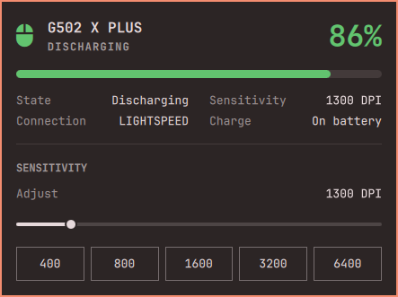

# Rodent

A bar widget for wireless mice on a Logitech receiver (LIGHTSPEED, Unifying, or Bolt). The mouse on the bar turns **green, yellow, or red** with the charge. Click it for percent, charging state, connection, DPI, and polling rate.

Rodent is a fork of [Quarezz/omarchy-g502x](https://github.com/Quarezz/omarchy-g502x), widened from one mouse family to any wireless mouse behind a receiver. Upstream PR [#1](https://github.com/Quarezz/omarchy-g502x/pull/1) is where the G502 X PLUS support and the sensitivity slider came from.



## Credits

This started as someone else's plugin and still stands on other people's work:

- **[omarchy-g502x](https://github.com/Quarezz/omarchy-g502x)** by **Quarezz** (MIT) — the plugin this forks.
- **[Omarchy](https://omarchy.org)** first-party **power**, **network**, and **bluetooth** widgets ([basecamp/omarchy](https://github.com/basecamp/omarchy)) — panel structure, theme tokens, hero + info grid, and the preset-button row.
- **[Solaar](https://github.com/pwr-Solaar/Solaar)** (`logitech_receiver`, Daniel Pavel and contributors, GPL-2.0) — HID++ battery and DPI. Solaar is not vendored, only imported if installed.
- **[AirPods for Omarchy](https://github.com/thisisgm/omarchy-pods)** by **thisisgm** — the quality bar for a themed wireless-device widget. No AirPods code is included.

## What it shows

- **Bar** — mouse glyph only, colored by charge: green at 50%+, yellow under 50%, red under 25%. Hover for the model, charge, state and DPI
- **Panel** — percent, charging or discharging, connection type, current DPI
- **Sensitivity** — a slider over the range the mouse reports, plus a preset row, same control style as power profiles. A mouse whose sensor reports a sparse list of values (the PRO X Superlight reports 89) gets a slider that walks exactly those, so it never offers a DPI the mouse would refuse
- **Polling rate** — one button per rate the mouse reports, from 125 Hz up. Hidden entirely on mice that do not expose it, and disabled while an onboard profile owns the mouse (the panel says so)
- **Low battery** — one critical notification when discharging hits the threshold (default 15%)

## Supported mice

Any mouse that Solaar can see through a Logitech receiver: LIGHTSPEED, Unifying, or Bolt. The widget asks the mouse what it can do instead of keeping a model list, so a mouse that reports a battery and a DPI feature just works.

Known to work with:

- G502 X LIGHTSPEED and G502 X PLUS (LIGHTSPEED receiver, from upstream)
- MX Master (Unifying receiver, tested with this fork)

**Not supported:**

- **Wired mice**, even when Solaar can see them.
- **Keyboards, headsets, and other non-mouse devices**.
- **Legacy HID++ 1.0 mice** (for example the G500). They have no HID++ 2.0 feature table, so their DPI lives in onboard profiles and is not readable this way.
- **Bluetooth-connected mice**, which bypass the receiver path.

## Requirements

- Omarchy (omarchy-shell)
- A wireless mouse paired to a Logitech LIGHTSPEED, Unifying, or Bolt receiver
- Charge comes from Solaar when it is installed, and from the kernel HID++ battery when it is not. **No sudo or pkexec is required.**
- DPI read/write uses the `logitech_receiver` Python module from Solaar. Install Solaar with Omarchy's package helper if you want DPI. If that library is missing, charge still works and DPI shows as —.

## Install

If you had the original plugin installed, remove it first — Rodent has its own ID:

```bash
omarchy plugin disable morf.g502x
omarchy plugin remove morf.g502x
```

Then:

```bash
omarchy plugin add https://github.com/grischder/omarchy-rodent.git --enable
```

Place it next to Bluetooth if it did not land there:

```bash
omarchy bar put grischder.rodent --after omarchy.bluetooth
```

Or **Omarchy menu → Plugins**.

## Uninstall

```bash
omarchy plugin disable grischder.rodent
omarchy plugin remove grischder.rodent
```

Nothing else is written. Removing the plugin does not change onboard mouse profiles.

## Settings

| Key | Default | Description |
|---|---|---|
| `showPercentage` | `true` | Show the charge percent next to the mouse glyph |
| `lowBatteryPercent` | `15` | Notify once when discharging falls to this |

## How it reads the mouse

- The helper opens receivers through Solaar, keeps the first device whose kind is `mouse`, and reads battery and DPI from it.
- Charge and state come from Solaar's battery report, which covers the battery features mice actually ship with. Sysfs (`/sys/class/power_supply/hidpp_battery_*`) is a fallback, so charge alone keeps working without Solaar.
- DPI range, step, or the full list of allowed values come from the mouse's own sensor list. Presets outside it are dropped rather than written and silently clamped.
- While the mouse sleeps its HID++ reads fail, but the receiver still lists it. The last reading stays on the bar and in the panel until the mouse answers again, rather than going blank on every idle.
- Polling rate comes from the HID++ report-rate features (`0x8060`, or the extended `0x8061`), the same ones Solaar's Report Rate setting uses. It only appears when the mouse reports options.
- The onboard-profile mode is read from `0x8100` (`0x20`). When an onboard profile is active, the mouse keeps the report rate in its own memory and refuses writes to it, so the rate buttons are disabled and the panel says why. Set **Onboard Profiles → Disabled** in Solaar, or switch profile from the mouse, to take control back; DPI keeps working either way.
- When two mice share a receiver, the first one Solaar lists is shown.

## Development

```bash
node --test tests/                     # pure logic in ui/Model.js
python3 -m unittest discover -s tests  # helper logic in scripts/status.py
python3 scripts/status.py              # one JSON line for the attached mouse
```

## Disclaimer

Not affiliated with, endorsed by, or sponsored by Logitech. Product names are used only to describe compatibility.
